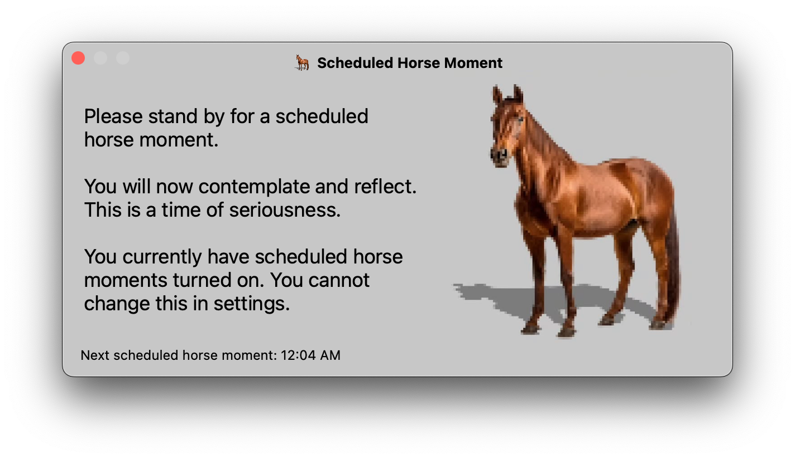

# Scheduled Horse Moment

Don't have the time and discipline to schedule your own horse moments? This app solves that problem. This app schedules horse moment for you at random intervals.

## Build

From the project root:

```sh
swift build -c release
```

The release binary is created at:

```
.build/release/BackgroundApp
```

SwiftPM also emits the resource bundle (for horse.png) at:

```
.build/release/BackgroundApp_BackgroundApp.bundle
```

## Install as a Background Task (auto-start on login)

1) Create a local install directory:

```sh
mkdir -p ~/.local/bin
```

2) Copy the release binary and bundle:

```sh
cp .build/release/BackgroundApp ~/.local/bin/scheduled-horse-moment
cp -r .build/release/BackgroundApp_BackgroundApp.bundle ~/.local/bin/
```

3) Create the LaunchAgent plist:

```sh
cat > ~/Library/LaunchAgents/com.user.scheduledhorsemoment.plist <<'PLIST'
<?xml version="1.0" encoding="UTF-8"?>
<!DOCTYPE plist PUBLIC "-//Apple//DTD PLIST 1.0//EN" "http://www.apple.com/DTDs/PropertyList-1.0.dtd">
<plist version="1.0">
<dict>
    <key>Label</key>
    <string>com.user.scheduledhorsemoment</string>
    <key>ProgramArguments</key>
    <array>
        <string>/Users/adelphia/.local/bin/scheduled-horse-moment</string>
    </array>
    <key>RunAtLoad</key>
    <true/>
    <key>KeepAlive</key>
    <true/>
    <key>StandardOutPath</key>
    <string>/tmp/com.user.scheduledhorsemoment.out</string>
    <key>StandardErrorPath</key>
    <string>/tmp/com.user.scheduledhorsemoment.err</string>
</dict>
</plist>
PLIST
```

4) Load it so it runs immediately and on startup:

```sh
launchctl unload ~/Library/LaunchAgents/com.user.scheduledhorsemoment.plist 2>/dev/null
launchctl load ~/Library/LaunchAgents/com.user.scheduledhorsemoment.plist
```

## Update the Background App

After code changes, rebuild and copy the new binary:

```sh
swift build -c release
cp .build/release/BackgroundApp ~/.local/bin/scheduled-horse-moment
cp -r .build/release/BackgroundApp_BackgroundApp.bundle ~/.local/bin/
launchctl unload ~/Library/LaunchAgents/com.user.scheduledhorsemoment.plist 2>/dev/null
launchctl load ~/Library/LaunchAgents/com.user.scheduledhorsemoment.plist
```

## Uninstall

```sh
launchctl unload ~/Library/LaunchAgents/com.user.scheduledhorsemoment.plist
rm -f ~/Library/LaunchAgents/com.user.scheduledhorsemoment.plist
rm -f ~/.local/bin/scheduled-horse-moment
rm -rf ~/.local/bin/BackgroundApp_BackgroundApp.bundle
```
